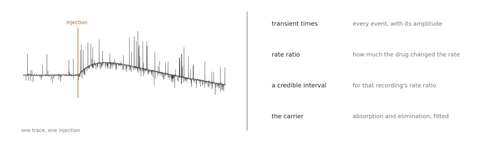
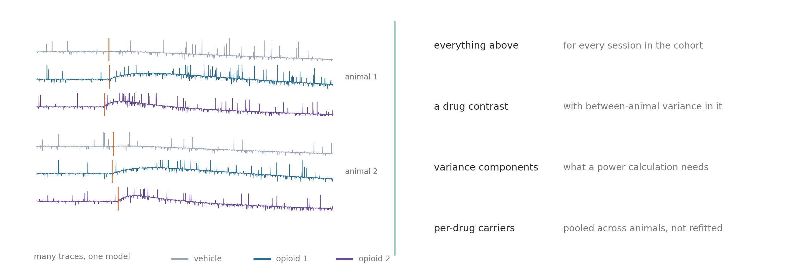

# PhotoSVI

**Transient detection and drug-response rate estimation for fiber photometry,
from one generative model.**

A photometry trace carries two signals a threshold cannot separate. A drug can shift
the baseline over minutes (the tonic response); individual dopamine transients ride
on top of it over hundreds of milliseconds. A detector must decide where the baseline
is before it can find transients above it, and that decision is the same one that
determines how many transients there are.

PhotoSVI writes both into one model and estimates them together:

```math
y_t = \underbrace{\hat{x}_t}_{\text{tonic carrier}}
+ \underbrace{(h * s_t a_t)}_{\text{marked point process}} + \varepsilon_t,
\qquad \log \lambda_t = \beta_0 + \beta_{\mathrm{inj}} g_t
```

The quantity an experiment asks about, the factor by which a drug changes the
transient rate, $e^{\beta_{\mathrm{inj}}}$, is a **parameter of the model**, not
something counted afterwards from a list of detections. Detection and rate estimation
become two readouts of one posterior.

## Two models

Both share the same phasic machinery and differ in what they are handed and what they
can therefore answer.

### `SingleTraceModel`: one recording



For asking what happened in a particular session: transients with times and
amplitudes, the rate ratio $e^{\beta_{\mathrm{inj}}}$ for that recording with a
credible interval, and that session's tonic response. Use it to screen
recordings, to get event times for downstream analysis, or when the session itself is
the unit of interest. Its interval has been checked against Hamiltonian Monte Carlo on
the same recordings: its width is 0.97 times the exact one.

### `HierarchicalModel`: a cohort



For the question an experiment is usually designed around: whether two drugs differ,
by how much, and with between-animal variability inside the interval rather than
averaged out of it. It places the per-session coefficients, and the carrier, in an
animal × drug hierarchy, reads the design off the index vectors, and includes only the
variance components that design can identify. Along the way it returns the variance
components themselves, which is what a power calculation for the next cohort needs,
and the tonic response of each drug, pooled across animals.

On simulated cohorts the width of the interval on a contrast matches the spread of the
estimate across cohorts. The estimate itself is shrunk toward zero (it recovered 76% of a
simulated effect at medium SNR), so the 90% interval contained the true effect in 80% of
cohorts. [`MODEL_CARD.md`](https://github.com/AbanteLab/photosvi/blob/main/MODEL_CARD.md) has the measurement.

## Install

```bash
pip install photosvi
```

Python ≥ 3.10. The heavy dependencies are PyTorch and Pyro; a GPU is optional and
only pays for the cohort model. For a CUDA build of PyTorch, install it first as
described at [pytorch.org](https://pytorch.org/get-started/locally/). The interactive
benchmark views need `pip install "photosvi[plots]"`.

To reproduce the paper or run the test suite, install from a clone instead:

```bash
git clone https://github.com/AbanteLab/photosvi.git
cd photosvi
pip install -e ".[dev]"
pytest tests/ -q
```

## Basic use

Two short scripts show the API:
[`single_trace.py`](https://github.com/AbanteLab/photosvi/blob/main/docs/examples/single_trace.py) fits one recording and reads the
rate ratio, and [`cohort.py`](https://github.com/AbanteLab/photosvi/blob/main/docs/examples/cohort.py) fits a cohort and reads a
drug contrast.

```bash
python single_trace.py
python cohort.py
```

Both run in seconds on the toy configuration shipped with the package
(`photosvi.api.config_path("toy.yaml")`), and the test suite runs them on every push.
The [documentation](https://abantelab.github.io/photosvi/) covers fitting your own
recordings, choosing settings for your sensor, and reproducing the benchmark.

Your own recordings, Doric files or dF/F traces, can be fitted from the command line:

```bash
photosvi kernel calibrate rec1.doric rec2.doric --out kernel.yaml   # if not dLight1.3b
photosvi fit session.doric --kernel kernel.yaml --out run/          # one recording
photosvi fit-cohort sessions.csv --reference vehicle --out run/     # a cohort
```

[Fit your own recordings](https://abantelab.github.io/photosvi/fit-your-recordings/)
describes the inputs, the table of sessions and what each command writes.

From your own data you need, for each recording, the raw sensor channel with its
isosbestic control (or a trace already corrected to dF/F), the injection time and the
sampling rate; for a cohort, also the animal and the condition. The isosbestic correction
to dF/F is done on loading, for Doric files and for any file that gives the control
channel.

The transient kernel is fixed during a fit and should match your sensor. Calibrate it
from your recordings first with `photosvi kernel calibrate` or `api.calibrate_kernel`,
described in [choosing your settings](https://abantelab.github.io/photosvi/settings/#the-kernel).

## What is in the repository

```
src/photosvi/
├── models/points/     the generative blocks and the Pyro model/guide pairs
├── inference/points/  the SVI loop, the stopping criterion, device selection
├── benchmark/         detection scoring: matched filter, GuPPy, PR/F1, NMS
├── experiments/       the simulation studies behind the paper
├── kernel_calibration.py  fitting the transient kernel to a sensor, before a fit
└── data/              loading and preprocessing hooks
configs/               every experiment's settings, one YAML each (a link to
                       src/photosvi/configs/, which ships with the package)
scripts/               entry points for the studies, and the figure generators
docs/                  the documentation source, and the runnable examples
```

[`MODEL_CARD.md`](https://github.com/AbanteLab/photosvi/blob/main/MODEL_CARD.md) records what the shipped model is set to and the measurement behind
each choice. Run outputs and generated figures are written outside the repository
(see `.gitignore`); what makes a result reproducible (the config, the seed and the
code version) is tracked here.

## Status

Version 1.0.0 is the code of the paper. [`MODEL_CARD.md`](https://github.com/AbanteLab/photosvi/blob/main/MODEL_CARD.md) records what the
shipped model is set to, the measurement behind each choice, and what is not yet
defended.

## Citation

If you use PhotoSVI, please cite the preprint:

G. Peytral, Z. Tariq, A. Essmann, Z. M. Garçon-Poca, D. Garcia Ortiz, C. Crook,
J. Bonaventura and J. Abante. Disentangling tonic and phasic dopamine in fiber
photometry from single recordings to cohorts. *bioRxiv* (2026).
https://doi.org/10.64898/2026.11.16.767032

```bibtex
@article{peytral2026photosvi,
  title   = {Disentangling tonic and phasic dopamine in fiber photometry from single recordings to cohorts},
  author  = {Peytral, Gabriel and Tariq, Zinnera and Essmann, Amelie and Gar{\c{c}}on-Poca, Zelai M. and Garcia Ortiz, David and Crook, Caitlin and Bonaventura, Jordi and Abante, Jordi},
  journal = {bioRxiv},
  year    = {2026},
  doi     = {10.64898/2026.11.16.767032}
}
```

## License

MIT; see [`LICENSE`](https://github.com/AbanteLab/photosvi/blob/main/LICENSE).
