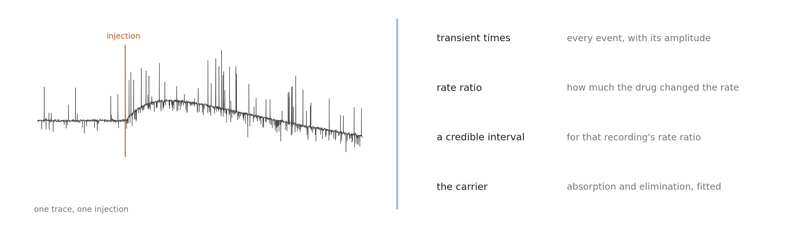
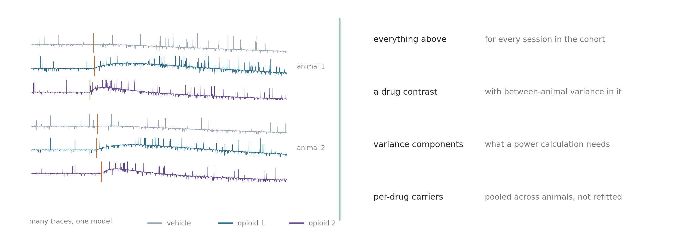

# PhotoSVI

PhotoSVI estimates **how much a drug changes the rate of dopamine transients** in a
fiber photometry recording, and finds the transients themselves, from one generative
model rather than two processing steps.

## The problem it solves

A photometry trace carries two signals that a threshold cannot separate. A drug can
shift the whole baseline over minutes (the tonic response); individual transients ride on
top of it over hundreds of milliseconds. A detector tuned to find transients must
first decide what they are transients *above*, and that decision, where the baseline
is, is the same decision that determines how many transients there are. Treating them
as separate steps leaves the answer to whichever step ran first.

PhotoSVI writes both into one model and estimates them together:

$$
y_t = \underbrace{\hat{x}_t}_{\text{tonic carrier}}
+ \underbrace{(h * s_t a_t)}_{\text{marked point process}} + \varepsilon_t,
\qquad \log \lambda_t = \beta_0 + \beta_{\mathrm{inj}} g_t
$$

The quantity the experiment asks about, the factor by which the drug changes the
transient rate, $e^{\beta_{\mathrm{inj}}}$, is a **parameter of the model**, not
something counted afterwards from a list of detections. Detection and rate estimation
become two readouts of one posterior.

## Two models

Both share the same phasic machinery and differ in what they are handed and what they
can therefore answer.

### `SingleTraceModel`: one recording

For asking what happened in a particular session: transients with times and
amplitudes, the rate ratio $e^{\beta_{\mathrm{inj}}}$ for that recording with a
credible interval, and that session's tonic response. Use it to screen
recordings, to get event times for downstream analysis, or when the session itself is
the unit of interest. Its interval has been checked against Hamiltonian Monte Carlo on
the same recordings: its width is 0.97 times the exact one.

### `HierarchicalModel`: a cohort

For the question an experiment is usually designed around: whether two drugs differ,
by how much, and with between-animal variability inside the interval rather than
averaged out of it. It places the per-session coefficients, and the carrier, in an
animal × drug hierarchy, reads the design off the index vectors, and includes only the
variance components that design can identify. Along the way it returns the variance
components themselves, which is what a power calculation for the next cohort needs,
and the tonic response of each drug, pooled across animals.

On simulated cohorts the width of the interval on a contrast matches the spread of the
estimate across cohorts. The estimate itself is shrunk toward zero (it recovered 76% of a
simulated effect at medium SNR), so the 90% interval contained the true effect in 80% of
cohorts. `MODEL_CARD.md` has the measurement.

## Where to start

- [Getting started](getting-started.md): install, and a first fit in ten lines.
- [Fit your own recordings](fit-your-recordings.md): a Doric file or a dF/F trace, from the command line or from Python.
- [Fit one recording](tutorials/single-trace.md): the single-trace model end to end.
- [Fit a cohort](tutorials/cohort.md): the hierarchical model, and reading a contrast.
- [Choosing your settings](settings.md): what to change for your sensor and protocol.
- [Reproducing the benchmark](reproducing-the-benchmark.md): re-run the detection comparison.

!!! warning "Status"
    Version 1.0.0 is the code of the paper. How far the intervals can
    be trusted is described in [Choosing your settings](settings.md#how-far-to-trust-the-interval).
